<div align="center">
  <!-- En-tête créatif -->
  

  <!-- Animation texte ciblant "Ce que fait le projet" et "Pourquoi c'est utile" -->
  

  <br/>

  <!-- Badges recommandés par GitHub -->
  <p>
    
    
    
    
    
  </p>
</div>

---

<!-- 1. CE QUE FAIT LE PROJET -->
## À propos du projet

**E-Commerce Microservices App (`ecom-ms-app`)** est une solution full-stack distribuée conçue pour orchestrer de manière modulaire et résiliente la gestion des clients, des catalogues de produits et de la facturation. Elle permet aux équipes d'ingénierie et aux entreprises de déployer des services métiers indépendants et hautement disponibles sans avoir à gérer les frictions de couplage monolithique ou les pannes en cascade, grâce à la découverte de services dynamique, la configuration centralisée et la tolérance aux pannes intégrée.

> [!NOTE]
> Pour une vue détaillée des choix de conception et des schémas système, consultez la [documentation d'architecture](docs/ARCHITECTURE.md) ainsi que la [spécification des APIs](docs/API.md).

<!-- APERÇU VISUEL (GIF + CAPTURES D'ÉCRAN EN MODE DROPDOWN) -->
### Aperçu en action

<div align="center">
  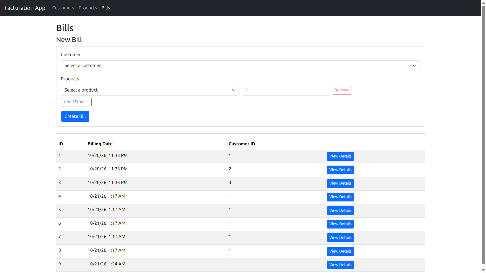
  <p><em>Interface Client Angular 19 : Création interactive d'une facture avec sélection dynamique du client et composition des lignes de commande.</em></p>
</div>

<details>
  <summary><b>Voir plus de captures d'écran (Interface, Microservices & Supervision — 27 captures)</b></summary>
  <br/>

  <!-- Étape 1 : Eureka Server -->
  <h4>Étape 1 : Service de Découverte (Netflix Eureka Server)</h4>
  <table width="100%">
    <tr>
      <td width="50%" align="center">
        <b>Capture 01 : Dashboard Eureka au démarrage</b><br/><br/>
        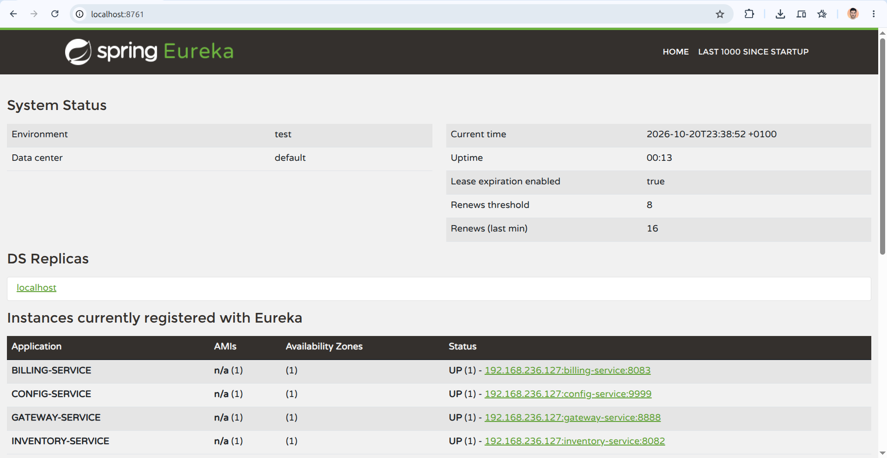
        <p><em>Initialisation du serveur Eureka (:8761)</em></p>
      </td>
      <td width="50%" align="center">
        <b>Capture 02 : Instances enregistrées dans Eureka</b><br/><br/>
        
        <p><em>Enregistrement dynamique des 4 services</em></p>
      </td>
    </tr>
    <tr>
      <td colspan="2" align="center">
        <b>Capture 03 : Registre d'applications JSON / XML</b><br/><br/>
        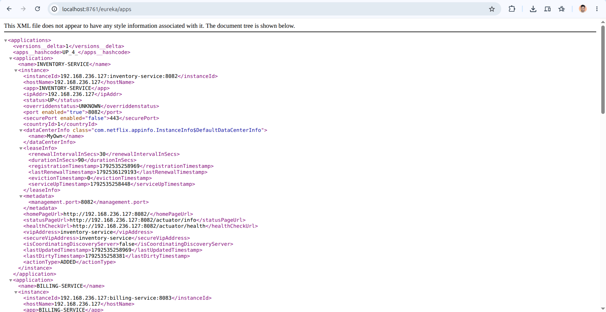
        <p><em>Consultation des métadonnées brutes sous /eureka/apps</em></p>
      </td>
    </tr>
  </table>

  <!-- Étape 2 : Config Server -->
  <h4>Étape 2 : Configuration Centralisée (Spring Cloud Config Server)</h4>
  <table width="100%">
    <tr>
      <td width="50%" align="center">
        <b>Capture 04 : Configuration Customer via Config Server</b><br/><br/>
        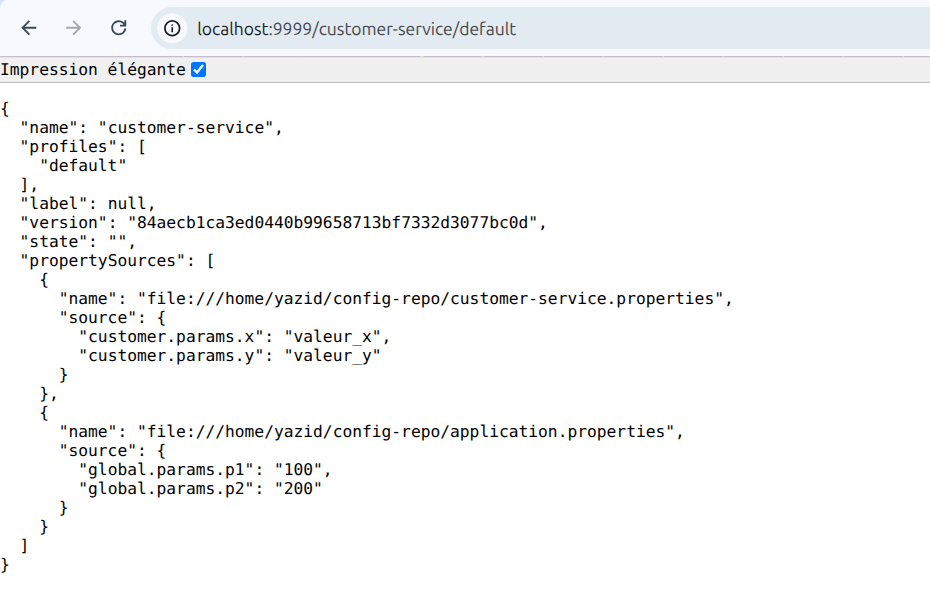
        <p><em>Profil de configuration distribué sur le port :9999</em></p>
      </td>
      <td width="50%" align="center">
        <b>Capture 05 : Test lecture des propriétés injectées</b><br/><br/>
        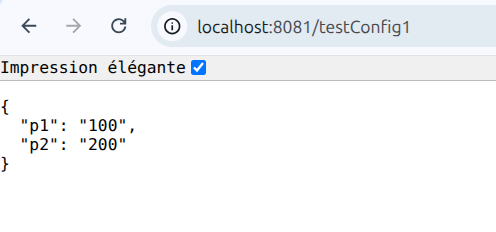
        <p><em>Injection dynamique via @Value (/testConfig1)</em></p>
      </td>
    </tr>
    <tr>
      <td width="50%" align="center">
        <b>Capture 06 : Test des paramètres typés (Record)</b><br/><br/>
        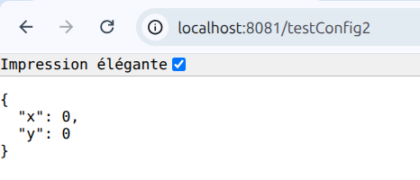
        <p><em>Binding typé CustomerConfigParams (/testConfig2)</em></p>
      </td>
      <td width="50%" align="center">
        <b>Capture 07 : Rechargement à chaud (Actuator Refresh)</b><br/><br/>
        
        <p><em>Rafraîchissement dynamique des beans @RefreshScope</em></p>
      </td>
    </tr>
  </table>

  <!-- Étape 3 : Customer Service -->
  <h4>Étape 3 : Microservice Customer (Gestion des Clients)</h4>
  <table width="100%">
    <tr>
      <td width="50%" align="center">
        <b>Capture 08 : Console H2 Database (customers-db)</b><br/><br/>
        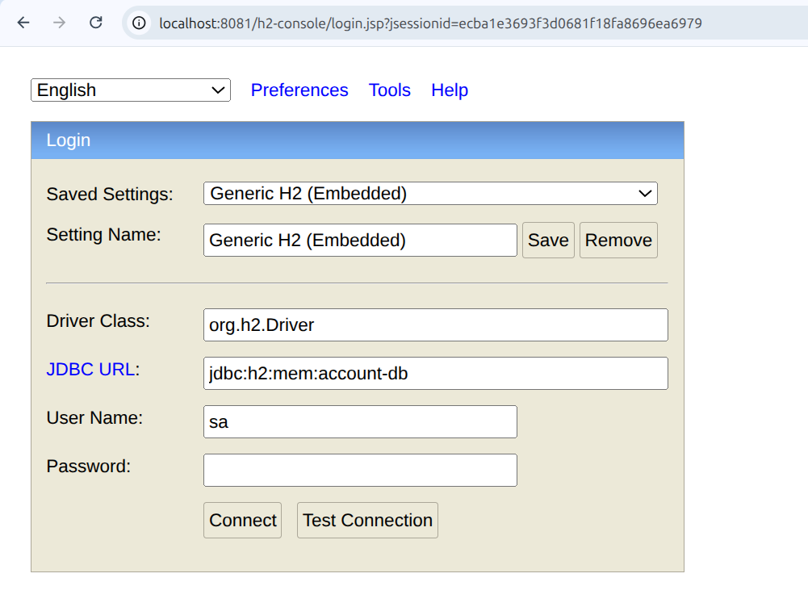
        <p><em>Schéma et données de la base mémoire des clients</em></p>
      </td>
      <td width="50%" align="center">
        <b>Capture 09 : Exposition Spring Data REST</b><br/><br/>
        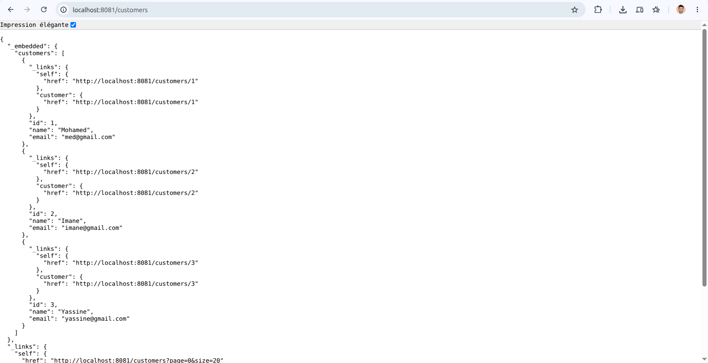
        <p><em>Collection HATEOAS des clients sous /customers</em></p>
      </td>
    </tr>
    <tr>
      <td width="50%" align="center">
        <b>Capture 10 : Création d'un nouveau client (POST)</b><br/><br/>
        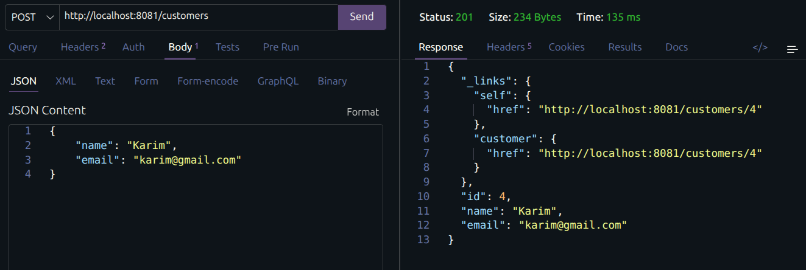
        <p><em>Insertion HTTP POST d'un client</em></p>
      </td>
      <td width="50%" align="center">
        <b>Capture 11 : Consultation d'un client par ID</b><br/><br/>
        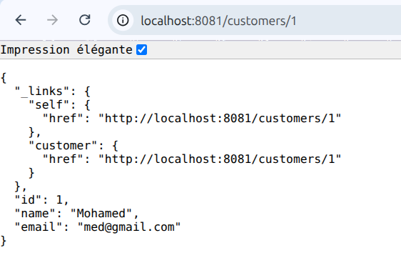
        <p><em>Requête GET /customers/1</em></p>
      </td>
    </tr>
  </table>

  <!-- Étape 4 : Inventory Service -->
  <h4>Étape 4 : Microservice Inventory (Gestion des Produits)</h4>
  <table width="100%">
    <tr>
      <td width="50%" align="center">
        <b>Capture 12 : Console H2 Database (products-db)</b><br/><br/>
        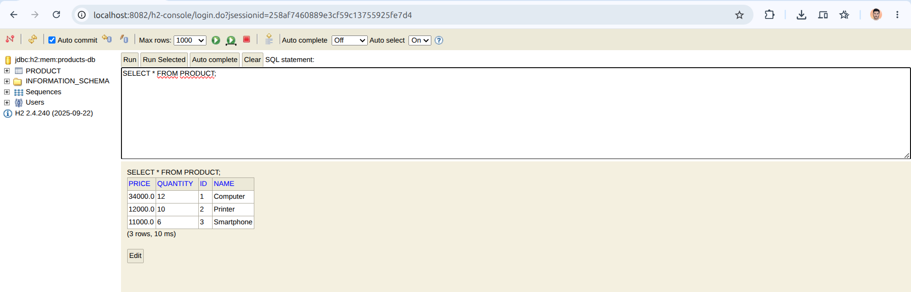
        <p><em>Stockage relationnel du catalogue de produits</em></p>
      </td>
      <td width="50%" align="center">
        <b>Capture 13 : Exposition Spring Data REST</b><br/><br/>
        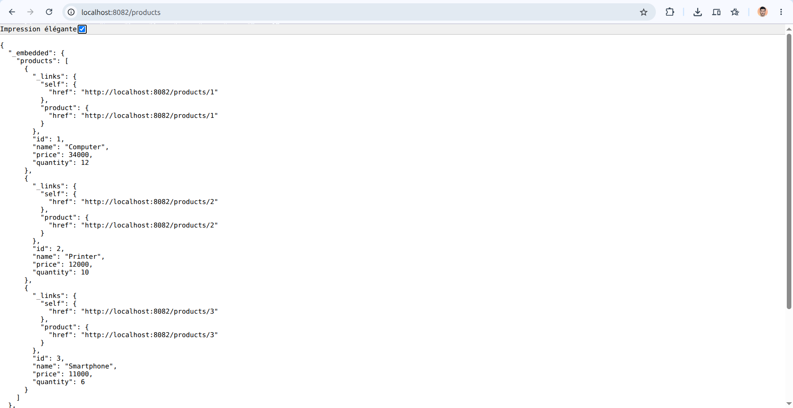
        <p><em>Collection des produits en stock (/products)</em></p>
      </td>
    </tr>
    <tr>
      <td colspan="2" align="center">
        <b>Capture 14 : Consultation d'un produit par identifiant</b><br/><br/>
        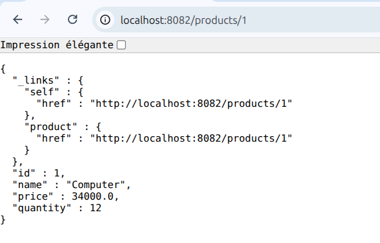
        <p><em>Détails du produit (prix, quantité) via GET /products/1</em></p>
      </td>
    </tr>
  </table>

  <!-- Étape 5 : Spring Cloud Gateway -->
  <h4>Étape 5 : Spring Cloud Gateway (Routage Dynamique & Reverse Proxy)</h4>
  <table width="100%">
    <tr>
      <td width="50%" align="center">
        <b>Capture 15 : Routage dynamique vers Customer Service</b><br/><br/>
        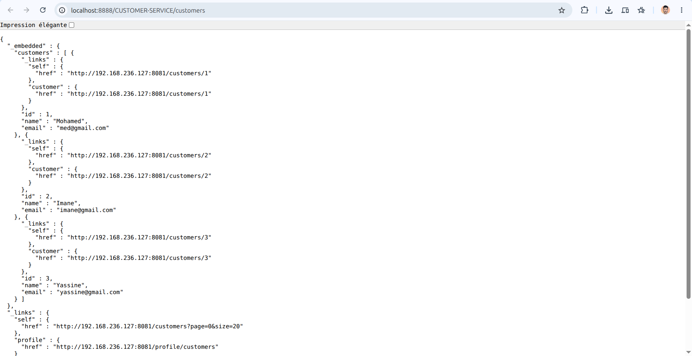
        <p><em>Accès à Customer Service via la Gateway (:8888)</em></p>
      </td>
      <td width="50%" align="center">
        <b>Capture 16 : Routage dynamique vers Inventory Service</b><br/><br/>
        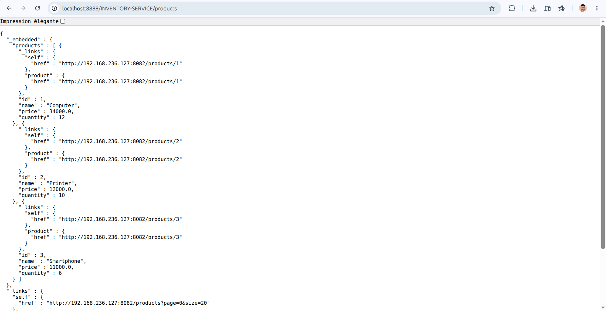
        <p><em>Accès à Inventory Service via la Gateway (:8888)</em></p>
      </td>
    </tr>
    <tr>
      <td width="50%" align="center">
        <b>Capture 17 : Routage dynamique vers Billing Service</b><br/><br/>
        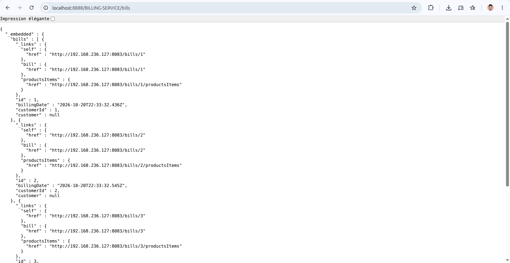
        <p><em>Accès à Billing Service via la Gateway (:8888)</em></p>
      </td>
      <td width="50%" align="center">
        <b>Capture 18 : Cartographie des routes Gateway</b><br/><br/>
        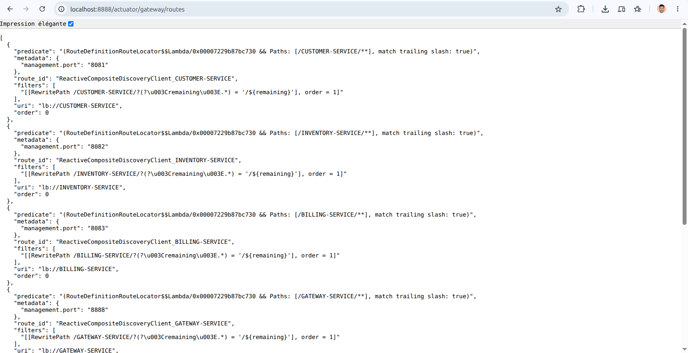
        <p><em>Inspection des routes via /actuator/gateway/routes</em></p>
      </td>
    </tr>
  </table>

  <!-- Étape 6 : Billing Service -->
  <h4>Étape 6 : Microservice Billing (OpenFeign, Resilience4j & Facturation)</h4>
  <table width="100%">
    <tr>
      <td width="50%" align="center">
        <b>Capture 19 : Console H2 Database (billing-db)</b><br/><br/>
        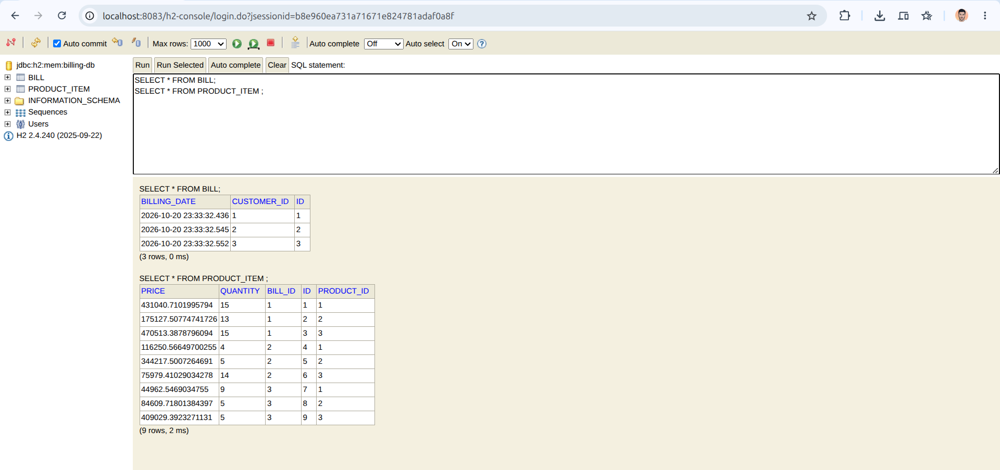
        <p><em>Tables BILL et PRODUCT_ITEM dans la base locale</em></p>
      </td>
      <td width="50%" align="center">
        <b>Capture 20 : Agrégation complète via OpenFeign</b><br/><br/>
        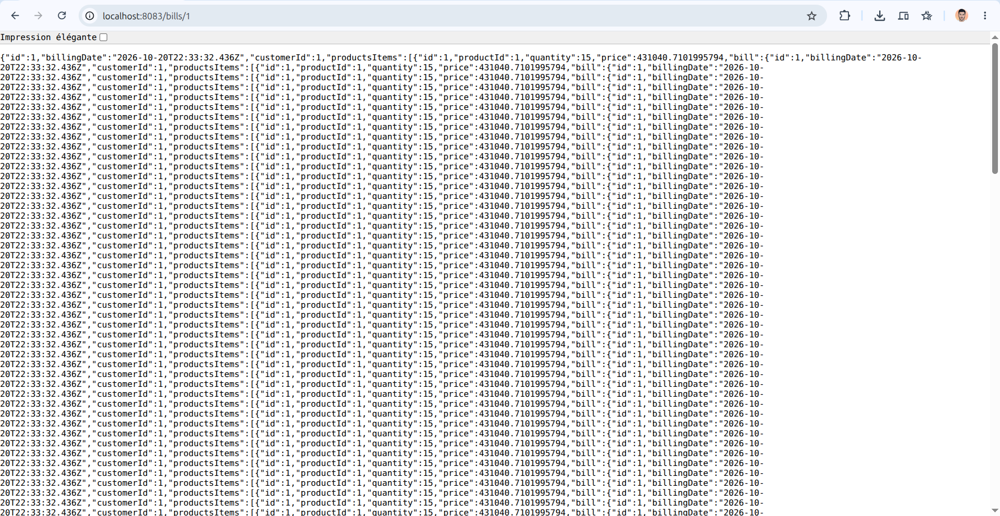
        <p><em>Facture enrichie avec Customer et Products résolus</em></p>
      </td>
    </tr>
    <tr>
      <td width="50%" align="center">
        <b>Capture 21 : Création complète d'une facture (POST)</b><br/><br/>
        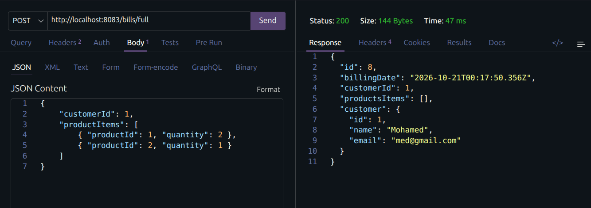
        <p><em>Création d'une facture avec ses lignes d'articles</em></p>
      </td>
      <td width="50%" align="center">
        <b>Capture 22 : Disjoncteur Resilience4j (Fallback)</b><br/><br/>
        
        <p><em>Déclenchement du profil client par défaut en cas de panne</em></p>
      </td>
    </tr>
  </table>

  <!-- Étape 7 : Frontend Angular 19 -->
  <h4>Étape 7 : Application Frontend Client (Angular 19)</h4>
  <table width="100%">
    <tr>
      <td width="50%" align="center">
        <b>Capture 23 : Interface principale & navigation</b><br/><br/>
        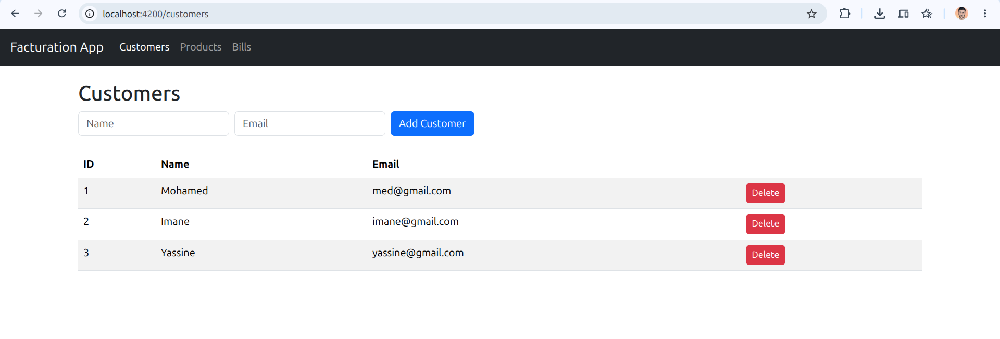
        <p><em>Page d'accueil SPA et barre de navigation</em></p>
      </td>
      <td width="50%" align="center">
        <b>Capture 24 : Gestion des clients (Consultation & Ajout)</b><br/><br/>
        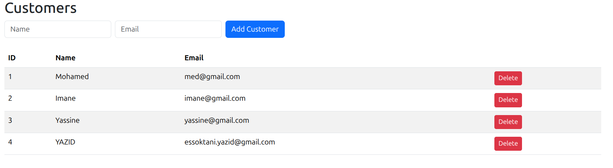
        <p><em>Tableau réactif et formulaire d'ajout des clients</em></p>
      </td>
    </tr>
    <tr>
      <td width="50%" align="center">
        <b>Capture 25 : Catalogue Produits (Stocks & Prix)</b><br/><br/>
        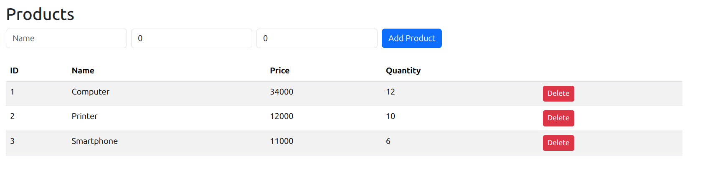
        <p><em>Consultation des articles disponibles en inventaire</em></p>
      </td>
      <td width="50%" align="center">
        <b>Capture 26 : Formulaire interactif de facturation</b><br/><br/>
        
        <p><em>Sélection client et composition dynamique du panier</em></p>
      </td>
    </tr>
    <tr>
      <td colspan="2" align="center">
        <b>Capture 27 : Consultation détaillée d'une facture</b><br/><br/>
        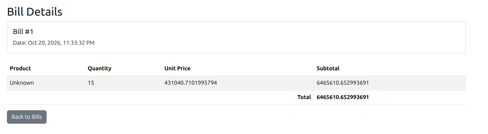
        <p><em>Calcul automatique des sous-totaux et du montant global TTC</em></p>
      </td>
    </tr>
  </table>
</details>

<!-- 2. POURQUOI LE PROJET EST UTILE -->
## Pourquoi utiliser ce projet ?

Ce projet répond à la problématique de passage à l'échelle et de résilience des systèmes e-commerce en apportant des avantages concrets :

- **Découverte dynamique & Routage intelligent :** Enregistrement automatique des microservices via Netflix Eureka Server et distribution transparente des flux via Spring Cloud Gateway sans adresses IP codées en dur.
- **Facturation distribuée & Tolérance aux pannes :** Communication inter-services synchrone avec Spring Cloud OpenFeign, sécurisée par des disjoncteurs Resilience4j empêchant la propagation des indisponibilités.
- **Gestion centralisée de la configuration :** Découplage de la configuration applicative via Spring Cloud Config Server et rafraîchissement à chaud à l'exécution via Spring Boot Actuator (`@RefreshScope`).
- **Expérience utilisateur réactive (SPA) :** Frontend monopage conçu avec Angular 19 et Bootstrap 5 pour une gestion fluide des clients, des stocks et des factures en temps réel.

### Stack Technique

| Couche | Technologies |
| :--- | :--- |
| **Backend & Microservices** | `Java 21`, `Spring Boot 4.1.1`, `Spring Cloud 2025.1.3` (Eureka Discovery, Spring Cloud Gateway, OpenFeign, Resilience4j, Config Server) |
| **Frontend / UI** | `Angular 19`, `TypeScript`, `RxJS`, `Bootstrap 5`, `HTML5 / CSS3` |
| **Données & Persistance** | `Spring Data JPA`, `Spring Data REST (HATEOAS)`, `H2 Database Engine (In-Memory)` |
| **DevOps & Supervision** | `Spring Boot Actuator`, `Maven (mvnw)`, `Git` |

---

<!-- 3. COMMENT DÉMARRER -->
## Pour commencer

Suivez ces instructions pour compiler, déployer et exécuter les microservices et le client web sur votre environnement local.

### Prérequis

Assurez-vous d'avoir installé les outils suivants sur votre environnement :

- `Java JDK` (v21+)
- `Apache Maven` (v3.9+) ou utilisation des wrappers `mvnw` inclus dans chaque microservice
- `Node.js` (v18+) & `npm` (v9+)
- `@angular/cli` (v19+) : `npm install -g @angular/cli`

### Installation & Démarrage

1. **Cloner le dépôt**
   ```bash
   git clone https://github.com/essoktani-yazid/spring-boot-microservice-tp2.git
   cd spring-boot-microservice-tp2
   ```

2. **Ordre strict de démarrage des services**

   > [!IMPORTANT]
   > En architecture microservices distribuée, l'ordre de démarrage est primordial pour permettre l'enregistrement auprès d'Eureka et la récupération des configurations.

   | Étape | Service | Port | Description | Commande de lancement |
   | :---: | :--- | :---: | :--- | :--- |
   | **1** | `discovery-service` | `8761` | Eureka Service Registry | `cd discovery-service && ./mvnw spring-boot:run` |
   | **2** | `config-service` | `9999` | Spring Cloud Config Server | `cd config-service && ./mvnw spring-boot:run` |
   | **3** | `customer-service` | `8081` | Microservice de gestion clients | `cd customer-service && ./mvnw spring-boot:run` |
   | **4** | `inventory-service` | `8082` | Microservice catalogue produits | `cd inventory-service && ./mvnw spring-boot:run` |
   | **5** | `billing-service` | `8083` | Microservice de facturation | `cd billing-service && ./mvnw spring-boot:run` |
   | **6** | `gateway-service` | `8888` | API Gateway & Reverse Proxy | `cd gateway-service && ./mvnw spring-boot:run` |
   | **7** | `ecom-client-ang` | `4200` | Frontend Client Angular 19 | `cd ecom-client-ang && npm install && npm start` |

---

### Exemple d'utilisation

Une fois tous les services démarrés, vous pouvez interagir avec le système via la passerelle Spring Cloud Gateway (`http://localhost:8888`) ou ouvrir l'interface web sur `http://localhost:4200`.

Exemples de requêtes cURL via la Gateway :

```bash
# 1. Lister les clients (Spring Data REST)
curl -X GET http://localhost:8888/CUSTOMER-SERVICE/customers

# 2. Lister les produits en inventaire
curl -X GET http://localhost:8888/INVENTORY-SERVICE/products

# 3. Récupérer une facture complète agrégée via OpenFeign
curl -X GET http://localhost:8888/BILLING-SERVICE/bills/1

# 4. Créer une nouvelle facture avec lignes de produits
curl -X POST http://localhost:8888/BILLING-SERVICE/bills/full \
  -H "Content-Type: application/json" \
  -d '{
    "customerId": 1,
    "productItems": [
      { "productId": 1, "quantity": 2 },
      { "productId": 2, "quantity": 1 }
    ]
  }'
```

*Pour découvrir l'ensemble des endpoints et paramètres disponibles, consultez la [Référence API complète](docs/API.md).*

---

### Structure du projet

```text
.
├── billing-service/       # Microservice Facturation (OpenFeign, Resilience4j, Spring Data)
├── config-service/        # Serveur de configuration centralisée Spring Cloud Config
├── customer-service/      # Microservice Clients (Spring Data REST, Actuator RefreshScope)
├── discovery-service/     # Registre de découverte Netflix Eureka Server
├── docs/                  # Documentation technique et spécifications
│   ├── assets/            # Ensemble des 27 captures d'écran du projet
│   ├── API.md             # Spécification détaillée des endpoints
│   └── ARCHITECTURE.md    # Architecture système et diagrammes de flux
├── ecom-client-ang/       # Frontend Single Page Application (Angular 19 & Bootstrap)
├── gateway-service/       # API Gateway réactive (Spring Cloud Gateway, CORS, dynamic routing)
├── inventory-service/     # Microservice Produits (Spring Data REST, H2)
├── pom.xml                # POM parent du projet racine
└── README.md              # Documentation principale du projet
```

---

<!-- 4. AIDE & SUPPORT -->
## Aide et Support

Vous avez une question sur l'architecture ou l'implémentation du projet ?
- **Documentation :** Consultez les fichiers techniques présents dans le dossier [`docs/`](docs/).
- **Contact direct :** N'hésitez pas à me contacter directement via LinkedIn ou mon portfolio.

---

<!-- 5. CONTRIBUTION & AUTEUR -->
## Contribuer

Les contributions et propositions d'améliorations sont les bienvenues !
1. **Forkez** le projet
2. Créez votre branche de fonctionnalité (`git checkout -b feature/NouvelleFonctionnalite`)
3. Commitez vos changements (`git commit -m 'feat: Ajout de NouvelleFonctionnalite'`)
4. Pushez vers la branche (`git push origin feature/NouvelleFonctionnalite`)
5. Ouvrez une **Pull Request**

## Auteur

<div align="center">

**Yazid ESSOKTANI**  
*Full-Stack Web & AI Developer*

[](https://www.essoktani.tech/)
[](https://www.linkedin.com/in/yazid-essoktani-337549251)
[](https://github.com/essoktani-yazid)

</div>

---

## Licence

Distribué sous la licence **MIT**. Consultez le fichier [`LICENCE`](LICENCE) pour plus d'informations.
