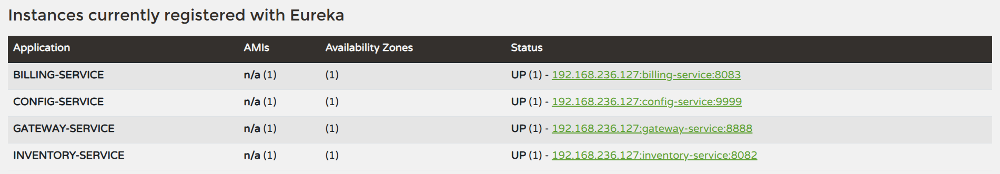
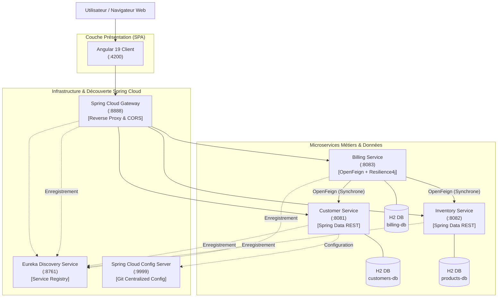
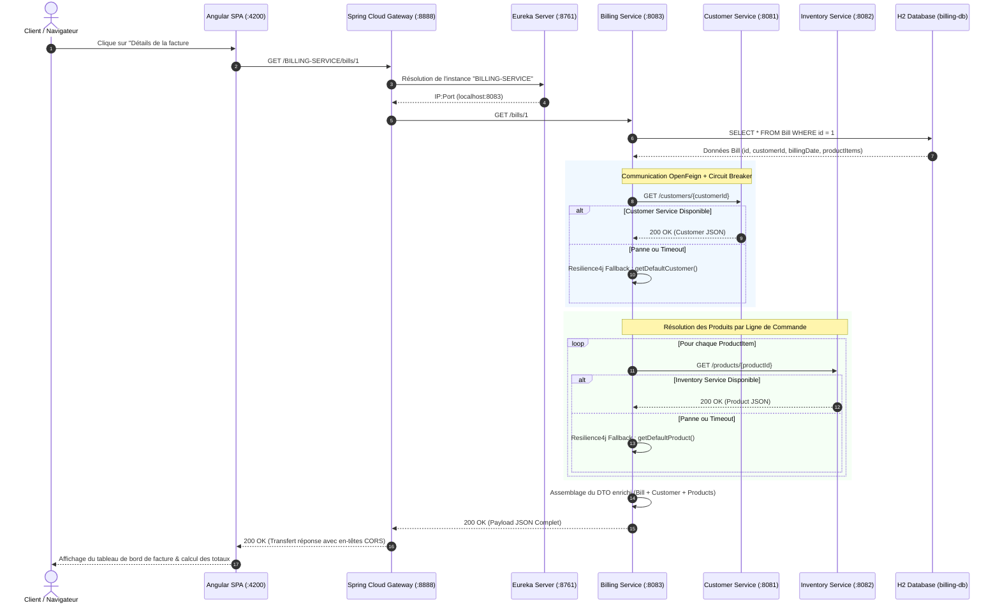
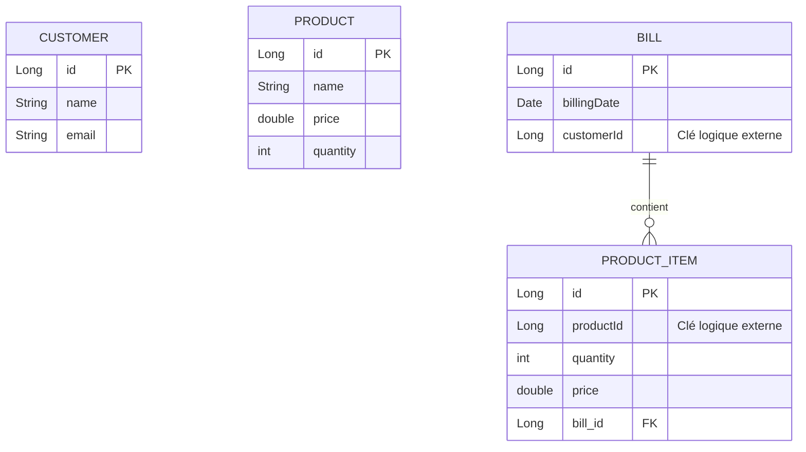
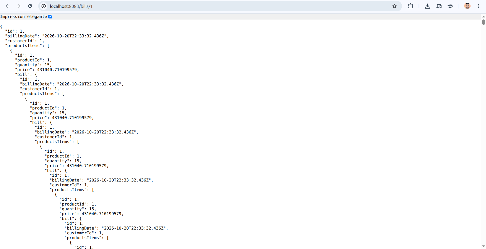
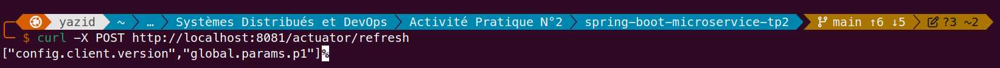

# Architecture du Système — E-Commerce Microservices App

> Ce document décrit l'architecture technique, les choix de conception, les composants et les flux de données du projet **E-Commerce Microservices App (`ecom-ms-app`)**.

---

## 1. Vue d'ensemble (High-Level Design)

L'application repose sur une **architecture microservices distribuée** propulsée par le framework **Spring Cloud** et un client web moderne développé en **Angular 19**. Elle adopte le principe fondamental du découpage par domaine métier (*Domain-Driven Design*) ainsi que le patron de conception **Database-per-Service**, garantissant un couplage faible, une scalabilité horizontale indépendante et une forte résilience aux pannes.

  
  
<em>Figure 1 : Enregistrement dynamique et état de santé des instances microservices sur Netflix Eureka Server</em>

### Topologie Globale du Système

---

## 2. Composants Principaux

| Composant | Technologie | Rôle & Responsabilités |
| :--- | :--- | :--- |
| **Frontend SPA** | `Angular 19`, `Bootstrap 5`, `RxJS` | Interface utilisateur monopage réactive : consultation des catalogues, gestion des clients, formulaire de passation et affichage détaillé des factures. |
| **API Gateway** | `Spring Cloud Gateway`, `Spring WebFlux` | Point d'entrée unique (`:8888`), gestion globale du CORS, routage statique (`/customers/**`, `/products/**`) et dynamique via Discovery Locator (`/{SERVICE-ID}/**`). |
| **Discovery Registry** | `Netflix Eureka Server` | Registre de découverte dynamique (`:8761`) assurant la localisation des services et l'équilibrage de charge côté client (*Client-Side Load Balancing*). |
| **Config Server** | `Spring Cloud Config Server` | Serveur de configuration centralisé (`:9999`) synchronisé avec un dépôt Git pour externaliser et versionner les paramètres d'environnement. |
| **Customer Service** | `Spring Boot`, `Spring Data REST`, `H2` | Gestion des clients (nom, email), persistance relationnelle, exposition HATEOAS et support du rechargement à chaud via `@RefreshScope`. |
| **Inventory Service** | `Spring Boot`, `Spring Data REST`, `H2` | Gestion du catalogue de produits et des niveaux de stock, persistance relationnelle, exposition des endpoints REST. |
| **Billing Service** | `Spring Boot`, `OpenFeign`, `Resilience4j`, `H2` | Orchestration de la facturation et des lignes d'articles (`ProductItem`), agrégation inter-services via clients déclaratifs OpenFeign et disjoncteurs de secours. |

---

## 3. Flux de données (Data Workflow)

Le diagramme suivant détaille le cycle de vie complet d'une requête complexe : **la consultation d'une facture détaillée (`GET /bills/{id}`)**, impliquant la découverte de services, la communication synchrone inter-microservices et le mécanisme de secours (*fallback*) Resilience4j :

---

## 4. Modèle de données & Stockage

Chaque microservice métier dispose de son propre schéma de base de données isolé (**Database-per-Service**), évitant tout verrouillage inter-bases direct.

### Entités Relationnelles (JPA)

- **Customer Service (`customers-db`) :**
  - Table `CUSTOMER` : identifiant auto-généré, nom complet et adresse e-mail.
- **Inventory Service (`products-db`) :**
  - Table `PRODUCT` : identifiant auto-généré, nom du produit, prix unitaire et stock disponible.
- **Billing Service (`billing-db`) :**
  - Table `BILL` : identifiant de facture, date d'émission et référence logique `customerId`.
  - Table `PRODUCT_ITEM` : ligne d'achat associant `productId`, quantité commandée, prix unitaire au moment de la facturation et clé étrangère locale vers `BILL`.
  - Attributs `@Transient` : les objets `Customer` et `Product` sont instanciés à la volée en mémoire lors des requêtes d'agrégation.

---

## 5. Résilience, Sécurité & Déploiement

### Tolérance aux pannes avec Resilience4j
- **Circuit Breaker :** Les interfaces Feign (`CustomerServiceRestClient`, `InventoryServiceRestClient`) sont annotées avec `@CircuitBreaker`. Si le taux d'erreur dépasse le seuil paramétré ou en cas de délai d'attente dépassé (*timeout*), le disjoncteur bascule à l'état `OPEN`.
- **Méthodes Fallback :**
  - `getDefaultCustomer(Long id, Exception exception)` : retourne un profil client par défaut (`name: "default"`, `email: "default@gmail.com"`).
  - `getDefaultProduct(Long id, Exception e)` : retourne un objet produit minimal contenant l'identifiant demandé, évitant ainsi un crash de l'interface utilisateur.

  
  
<em>Figure 2 : Tolérance aux pannes — Déclenchement automatique du Fallback Resilience4j lors de l'arrêt du Customer Service</em>

### Sécurité & Gestion Cross-Origin (CORS)
- **Filtre Réactif :** Un bean `CorsWebFilter` configuré dans `gateway-service` intercepte toutes les requêtes entrantes pour autoriser les origines `http://localhost:4200`, `http://localhost:3000` et `http://localhost:5173` avec les méthodes HTTP `GET, POST, PUT, DELETE, PATCH, OPTIONS`.
- **Pas de proxy complexe :** L'application front-end communique de manière unifiée avec le port `8888`.

### Configuration Dynamique & Rechargement à chaud
- Externalisation des propriétés métiers (`customer.params.x`, `customer.params.y`, `global.params.p1`, etc.) dans un dépôt Git via **Spring Cloud Config Server**.
- L'annotation `@RefreshScope` sur les contrôleurs cibles permet de propager les nouvelles valeurs instantanément via un simple appel POST à l'endpoint Spring Boot Actuator (`/actuator/refresh`) sans redémarrer le microservice.

  
  
<em>Figure 3 : Rechargement à chaud des beans Spring annotés avec @RefreshScope via Actuator</em>

---

[⬅ Retour au README principal](../README.md)
